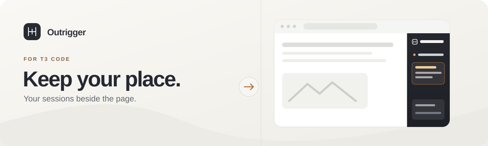
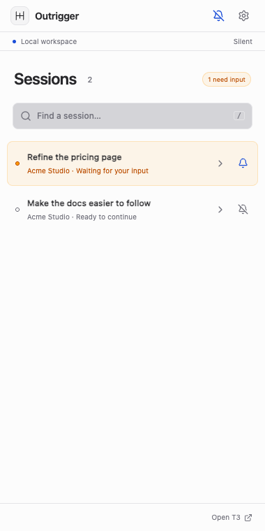
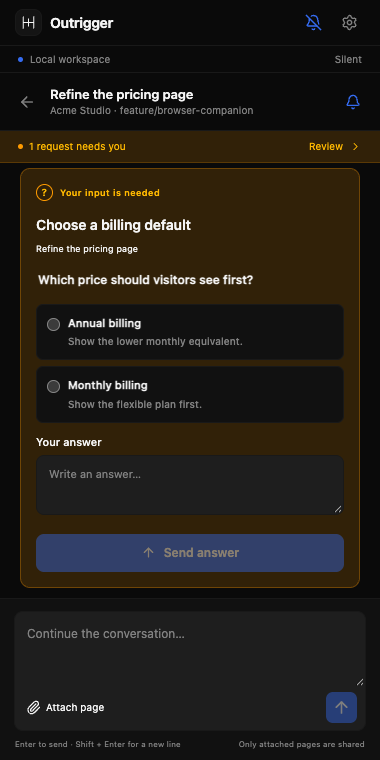

> **Outrigger is retired.** Its coding-session panel is being merged into [BaneySpaces](https://github.com/baney75/baneyspaces), whose Deck already tracks T3 Code, Claude Code and other agent sessions. This repository is archived; existing releases still download.

# Outrigger



**Your T3 Code sessions, beside your browser.** Outrigger is an independent Chrome side panel for continuing an existing conversation, answering a waiting request, and attaching the page you choose. T3 Code remains the home of the session and its full history.

<p align="center">&nbsp;&nbsp;</p>

## Install

Outrigger needs a running, reachable **T3 Code 0.0.44 or 0.0.45** server (orchestration protocol 1) and **Chrome 120 or newer**. It has no Chrome Web Store listing, so you load it as an unpacked extension. It was tested in **Chromium 153.0.8010.12**.

### Install from the release ZIP

No Node.js or npm is needed.

1. Download the ZIP from [the latest release](https://github.com/baney75/outrigger/releases/latest) and extract it to a folder you will keep. Chrome reads the extension from that folder every time it starts.
2. Open `chrome://extensions` and turn on **Developer mode**.
3. Choose **Load unpacked** and select the extracted folder that contains `manifest.json`.
4. Start T3 Code. In **Settings → Connections**, create a fresh pairing link. The `t3 serve` command also prints one. Keep that server running and reachable from Chrome.
5. Click the Outrigger toolbar icon, paste the pairing link, and grant access to that server origin.
6. Open a session to see its recent messages.

### Build from source

Building needs **Node.js 22.12 or newer**.

1. Clone this repository, then run:

   ```sh
   npm ci
   npm run build
   ```

2. Open `chrome://extensions`, turn on **Developer mode**, choose **Load unpacked**, and select this repository's `dist` folder.
3. Pair as in steps 4–6 above.

**Success check:** Your session title appears in the panel; opening it shows the same recent conversation. Type a short message and send it only when you intend to continue that session. The new message should appear in T3 Code. Treat a pairing link like a password, and pair only with a server you trust.

[Install T3 Code](https://github.com/pingdotgg/t3code/blob/main/docs/user/install.md) · [T3 Code remote access and pairing](https://github.com/pingdotgg/t3code/blob/main/docs/user/remote-access.md)

## Use it

- **Continue where you left off.** Search and open a current T3 Code session. Outrigger shows recent messages; open T3 Code for full history and other T3 features.
- **Handle a request.** Waiting questions and supported approval choices appear in the conversation. Review the details before answering. When Outrigger cannot show enough context, use **Review in T3 Code**.
- **Attach a page deliberately.** Select text on a web page, click Outrigger’s toolbar icon on that tab, then press **Attach page**. Repeat the toolbar click after switching to another site to grant temporary access. Review or remove the preview before sending. Only the page title, a cleaned URL, and up to 12,000 characters of selected text are attached. URL credentials, query parameters, and fragments are removed.
- **Keep your draft.** Drafts are saved locally per server and session, including while disconnected. A send is never silently replayed. If delivery is uncertain, Outrigger locks the draft until you check the conversation in T3 Code and explicitly make it editable again.
- **Choose when to be notified.** Silent mode starts on. Watch individual sessions with their bell, then enable notifications if you want desktop alerts for new requests that need you. Badges can still show attention in silent mode; alerts contain no conversation text.
- **Match your palette.** Choose an included T3 Code palette or import a custom theme JSON exported from T3 Code, including its light and dark variants. T3's desktop theme choice is local to T3 and cannot automatically sync here: choose or import it once in Outrigger. **Follow T3 server default** follows the server default only.

## Compatibility and limits

| Area         | Current scope                                                                                                                                                                                                                                                                                                                                     |
| ------------ | ------------------------------------------------------------------------------------------------------------------------------------------------------------------------------------------------------------------------------------------------------------------------------------------------------------------------------------------------- |
| T3 Code      | Released **0.0.44 and 0.0.45**, orchestration protocol **1**, both verified against isolated upstream servers. The **0.0.46** preview and nightly builds use orchestration protocol **2**, which this release does not support; Outrigger rejects it at pairing. A weekly job checks the latest published release. Unknown protocols fail closed. |
| Browser      | Manifest V3; declared minimum **Chrome 120**. Tested in **Chromium 153.0.8010.12**. Other browser/version combinations have not been verified.                                                                                                                                                                                                    |
| Install      | Local unpacked extension. There is no store listing.                                                                                                                                                                                                                                                                                              |
| Connection   | Direct connection to the T3 Code server in your pairing link. Plain HTTP is accepted only for loopback hosts; other origins require HTTPS. The browser must be able to reach the server.                                                                                                                                                          |
| Conversation | Recent message display and supported question/approval controls. T3 Code remains available for full history and actions that need its native interface.                                                                                                                                                                                           |

Outrigger collects no browsing history and has no telemetry or vendor backend. A paired T3 server and any provider it uses remain separate services. The bearer credential is stored in `chrome.storage.local` with trusted-context access; this is **not an encrypted vault**. See [privacy](docs/privacy.md) and [security](SECURITY.md).

## Troubleshooting

**The server is unreachable.** Confirm T3 Code is running and that Chrome can open its address in a tab. A server bound to `127.0.0.1` accepts connections only from the same machine; to reach it from another device, start it on a reachable host or through Tailscale, then create a new pairing link from that address. Pairing links are single use and expire, so create a fresh one for each attempt.

**HTTPS and Tailscale origins.** Outrigger accepts plain `http://` only for `localhost`, `127.0.0.1`, and `[::1]`. Every other origin must use `https://`. For a Tailscale tailnet, serve T3 Code over HTTPS (for example with `t3 serve --tailscale-serve`) and pair with the resulting `https://` address. A bare tailnet IP or hostname over `http://` is refused. When Chrome asks for access to the server origin, grant it; if you dismissed the prompt, pair again.

**The session list is empty.** Outrigger lists sessions on the server you paired with. Check that the pairing link came from the T3 Code you are using, and that you did not pair with a test or second server. Archived sessions are not listed. Start a session in T3 Code, then reopen the panel. If the panel reports an unsupported protocol, your T3 Code is newer than Outrigger supports; see the compatibility table below.

**Chrome warns about developer-mode extensions.** Chrome shows this notice for any unpacked extension, because Outrigger is not distributed through the Chrome Web Store. Keep Developer mode on to keep the extension loaded. You can dismiss the warning; it does not mean the extension is broken. To update, replace the extracted folder with the new release and choose **Reload** on `chrome://extensions`.

## Develop and verify

```sh
npm ci
npx playwright install chromium
npm run check
```

`check` runs type checking, unit tests, a production build, and packaged Chromium tests. The optional isolated upstream smoke is described in [live testing](docs/live-testing.md). Observed results and their limits are in [verification](docs/verification.md); the data flow is in [architecture](docs/architecture.md).

Outrigger is made by Donovan Baney under the [MIT license](LICENSE). The interface was designed with Claude Opus 5.5 in native Cursor. The idea was inspired in part by a conversation with Maria Rocks. Outrigger is independent of T3 Code and is not an official T3 Tools product. T3 Code palette material retains its upstream [MIT notice](docs/T3-LICENSE.txt).

## Sponsors

<!-- sponsors:start -->
No sponsors yet. [Sponsor on GitHub](https://github.com/sponsors/baney75) and your name appears here automatically.
<!-- sponsors:end -->
