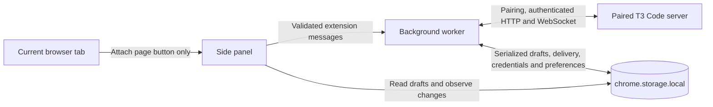

# Architecture

Outrigger is a Manifest V3 extension with a React side panel and a background service worker. It is a client of a chosen T3 Code server, not a second session store.

## Boundaries that matter

- **Pairing and protocol.** The panel asks the user to paste a T3 pairing link and requests permission for that server origin. The worker exchanges the one-time token, keeps the bearer credential, validates incoming data, and maintains the HTTP/WebSocket connection. Only orchestration protocol 1 is admitted. A changed or invalid protocol response closes the connection instead of guessing how to continue.
- **Presentation and actions.** The panel receives a credential-free state snapshot from the worker. It shows active sessions, recent conversation content, and supported waiting requests. User actions go back to the worker as validated extension messages. T3 Code remains authoritative for sessions, messages, approvals, and full history.
- **Draft and delivery state.** A draft key includes the server environment and thread identity. The panel saves the draft before submission and marks it uncertain until a receipt arrives. A rejected command restores the draft; an accepted command clears only the revision that was submitted. All draft writes are serialized by the background worker; a later edit from another view survives the receipt. A lost acknowledgement leaves the draft locked. Pending question and approval responses are also persisted before dispatch and remain locked after reload until an authoritative snapshot resolves them. Neither the client nor reconnect loop automatically replays a send.
- **Page attachment.** The panel reads the current tab only after **Attach page** is pressed. It captures the title, strips credentials/query/fragment from an HTTP(S) URL, and limits selected text to 12,000 characters. The preview is editable by removal; context joins the message only when the user sends it. Page text is labeled as user-attached content, not instructions.
- **Attention.** Watching a session and turning off silent mode are separate choices. The worker deduplicates newly waiting requests, suppresses initial/reconnect backlog, and omits conversation text from OS notifications. The badge can show waiting count in silent mode.
- **Themes and content.** Built-in T3 Code palettes are data tokens. Imported JSON is validated as literal colors; theme CSS is never executed. Message Markdown does not render remote images, and links are limited to HTTP(S). Content scripts are injected only for the explicit attachment action.

The extension requests `sidePanel`, `storage`, `alarms`, `activeTab`, and `scripting` permissions. Notification permission is optional, as are host permissions granted for the selected T3 server. There is no analytics endpoint, account service, or vendor backend in this repository. The paired T3 server and its configured providers have their own data handling.

Implementation entry points: [`src/main.tsx`](../src/main.tsx), [`src/background.ts`](../src/background.ts), [`src/t3/client.ts`](../src/t3/client.ts), and the [manifest](../public/manifest.json). The [privacy page](privacy.md) describes what is stored and sent.
